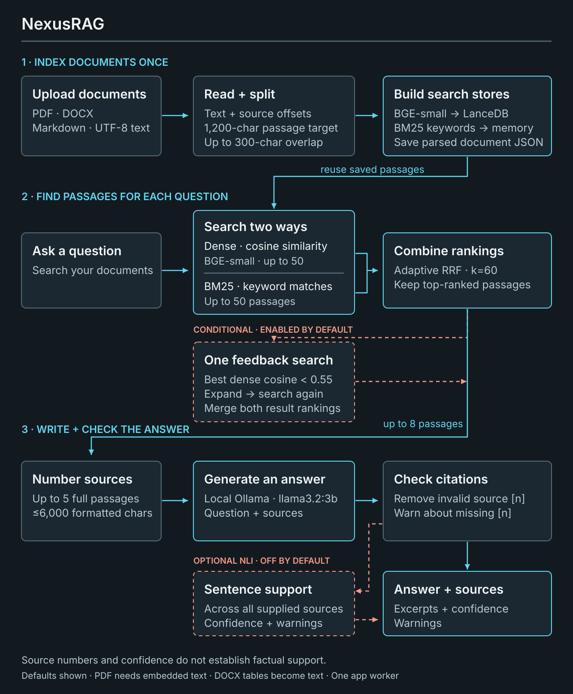
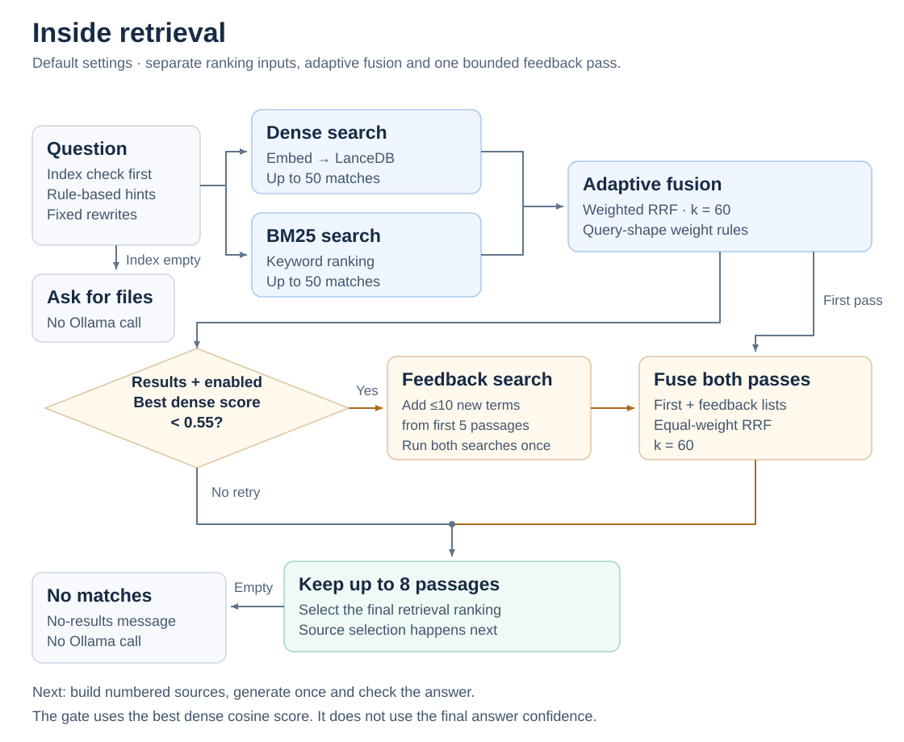
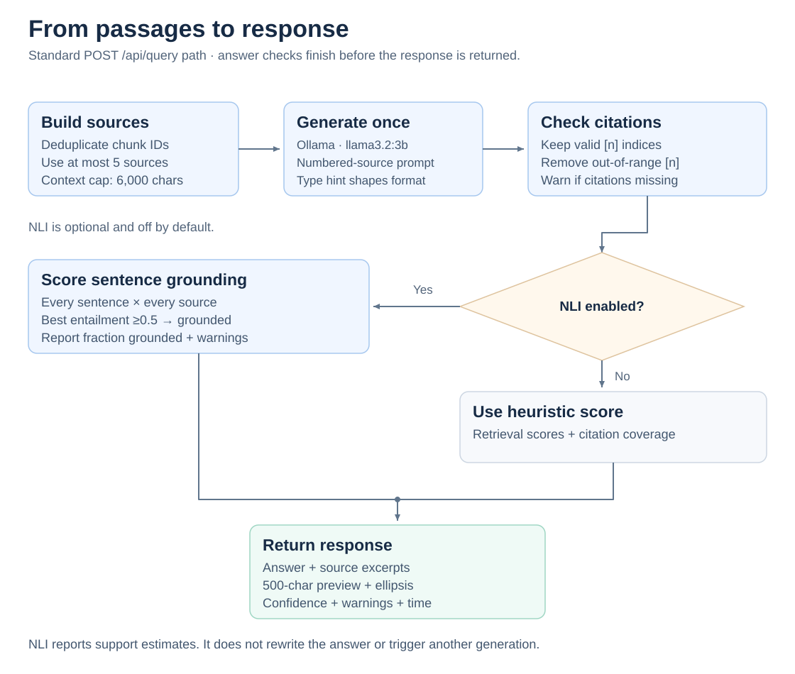
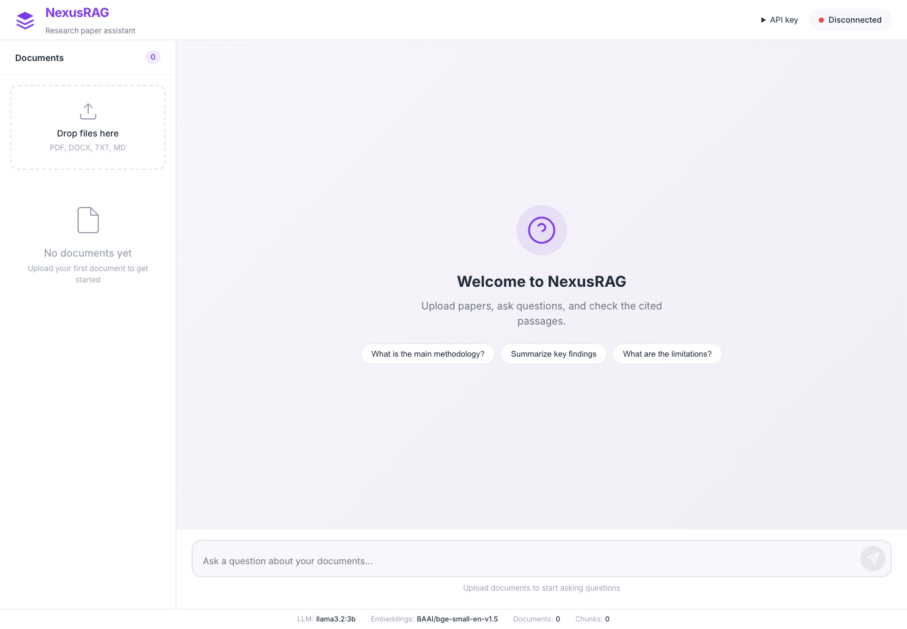
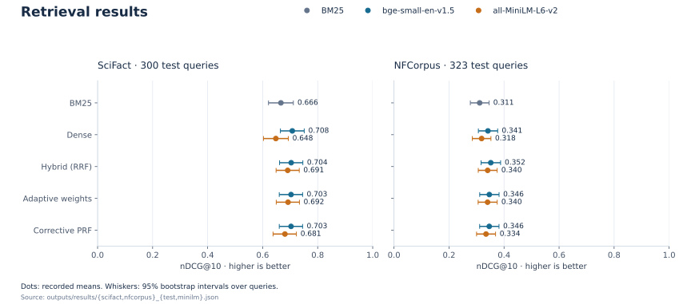
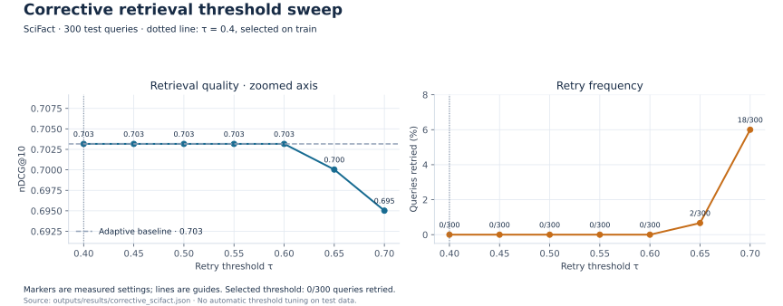
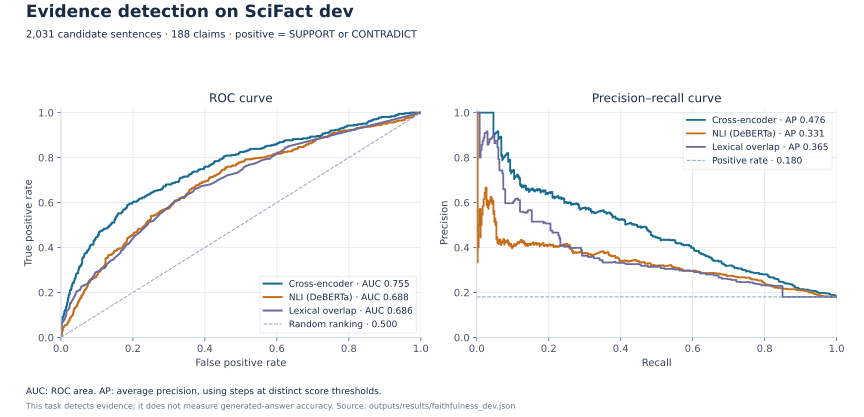

# NexusRAG

Search research papers with dense embeddings and BM25. Ask a local Ollama model for answers with cited passages, then inspect the sources. Built with Python, PyTorch, sentence-transformers, NumPy, LanceDB and FastAPI.

## Pipeline



Each dense or BM25 search considers up to **50 candidates**. The pipeline keeps up to **eight passages** and uses at most **five sources** for generation. Correction is limited to one feedback search; NLI grounding is off by default.

<details>
<summary>Retrieval and answer checks</summary>





[Pipeline rules, defaults and source code](docs/pipeline.md).

</details>

## Interface



Earlier interface screenshot, captured with no documents indexed and the service disconnected. It shows the upload and question layout, not a generated answer.

## Run locally

Use Python **3.11+**. Install and start [Ollama](https://ollama.com/), then run:

```bash
git clone https://github.com/urmeo/nexus-rag.git
cd nexus-rag
python -m venv .venv
source .venv/bin/activate
python -m pip install -e .
ollama pull llama3.2:3b
scinexusrag
```

Open [http://127.0.0.1:8000](http://127.0.0.1:8000). Upload PDF, DOCX, Markdown or UTF-8 text and ask a question. [Try the fictional sample paper](examples/sample_paper.md).

Models need downloads on first use. Documents and indexes default to `data/`. Run **one application worker** because BM25 indexes and rate-limit counters are per process.

Copy [.env.example](.env.example) to `.env` to change settings. Generation sends retrieved text to `OLLAMA_BASE_URL`, which defaults to local Ollama. Use `ollama serve` if the server is not already running. [Setup, Docker and checks](CONTRIBUTING.md).

## Results

### Retrieval

Full BEIR test splits: **300 SciFact queries** over **5,183 abstracts** and **323 NFCorpus queries** over **3,633 documents**. Higher nDCG@10 is better. Hybrid, adaptive and corrective rows use BGE-small embeddings.

| System | SciFact nDCG@10 | NFCorpus nDCG@10 |
| --- | ---: | ---: |
| Dense · MiniLM | 0.648 | 0.318 |
| BM25 | 0.666 | 0.311 |
| Dense · BGE-small | 0.708 | 0.341 |
| Hybrid · RRF | 0.704 | 0.352 |
| Adaptive weights | 0.703 | 0.346 |
| Corrective PRF | 0.703 | 0.346 |



Combining methods did not consistently improve the scores. Corrective retrieval triggered no retries on SciFact at the headline threshold of **0.55**. Reranking was disabled in these evaluations; the library and evaluation tools provide a cross-encoder reranker.

### Retrieval time and corrective threshold

First **120 SciFact test queries**, one CPU pass without warmup. Indexing and answer generation are excluded; initial reranker loading is included.

| System | nDCG@10 | Milliseconds per query |
| --- | ---: | ---: |
| Adaptive hybrid | 0.734 | 16.9 |
| Corrective PRF | 0.734 | 17.3 |
| Cross-encoder reranking | 0.702 | 1318.9 |

This experiment selected a corrective threshold of **0.40** on **250 training queries**, separate from the headline threshold of **0.55**. Neither threshold triggered retries on the SciFact test set. Timings have no repeated-run intervals.



The points are measured settings; connecting lines guide the eye. Thresholds of **0.65** and **0.70** triggered retries and reduced test nDCG in this sweep.

### Evidence-sentence detection

**188 SciFact development claims**, **2,031 candidate sentences**, **18.0% positive**. Candidates come from annotated abstracts. Both supporting and contradicting rationale sentences count as evidence.

| Scorer | ROC-AUC | Average precision | F1 |
| --- | ---: | ---: | ---: |
| Lexical overlap | 0.686 | 0.365 | 0.112 |
| NLI | 0.688 | 0.331 | 0.368 |
| Cross-encoder | 0.755 | 0.476 | 0.469 |



F1 thresholds were selected on **120 training claims**. This task measures evidence detection, not generated-answer accuracy.

### Protocol and provenance

Retrieval uses exact CPU search over NumPy vectors, seed **0**, depth **50**, RRF **k=60** and linear nDCG gains. Each benchmark document is one passage; the application chunks documents and uses LanceDB.

Retrieval intervals use **10,000 query bootstrap samples**. Paired tests use **10,000 randomizations**, with Holm correction within each dataset. Evidence ROC-AUC intervals use **2,000 claim bootstraps**. [Raw results](outputs/results) retain individual scores, revisions, source hashes and runtime versions. [Evaluation details and reproduction commands](docs/evaluation.md).

## Architecture

| Stage | Implementation |
| --- | --- |
| Ingest | Parse PDF, DOCX, Markdown or text; split at a 1,200-character target, with a 1,500-character maximum and up to 300 characters of paragraph overlap |
| Retrieve | Exact LanceDB cosine search and in-memory BM25; adaptive rank fusion; at most one feedback search below 0.55 dense similarity |
| Generate | Ollama `llama3.2:3b`; remove invalid citation indices; optionally score sentence grounding with NLI |
| Serve | FastAPI and a packaged web interface; one worker; optional API-key authentication, upload guards and rate limits |

## Tech stack

| Layer | Tools |
| --- | --- |
| Language and API | Python 3.11+, FastAPI, Uvicorn |
| Models and retrieval | PyTorch, sentence-transformers, BGE-small, NumPy, LanceDB, PyArrow, rank-bm25 |
| Generation and grounding | Ollama, httpx, DeBERTa NLI |
| Interface | HTML, CSS, JavaScript |
| Evaluation and plots | BEIR and SciFact datasets, NumPy, SciPy, Matplotlib |

## Limitations

- Abstract-level retrieval and evidence benchmarks do not establish full-paper answer accuracy. Check answers against the retrieved passages.
- Citation validation checks source indices. Optional NLI scores each answer sentence against all supplied sources; it does not verify that a particular inline citation supports the sentence.
- Confidence is a heuristic unless NLI grounding is enabled. Neither score guarantees correctness.
- Exact vector search scales linearly. BM25 rebuilds in memory and requires one application worker.
- Corrective retrieval can reduce ranking quality. Ollama model tags can change.

[Folder guide](docs/layout.md) · [Notebook](notebooks/01_quickstart.ipynb) · [Examples](examples) · [Regenerate charts](docs/evaluation.md#regenerate-the-charts) · [References](docs/evaluation.md#references) · [MIT license](LICENSE)

Sole contributor: [urmeo](https://github.com/urmeo).
