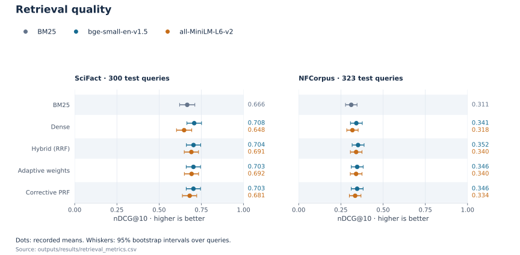
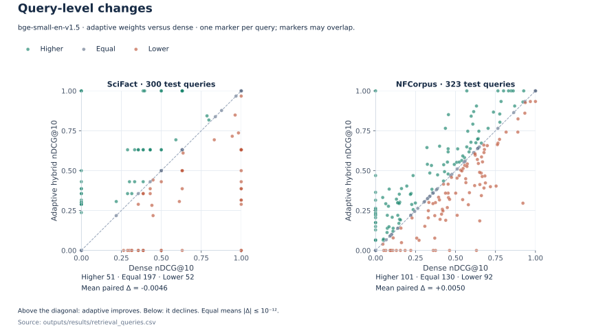
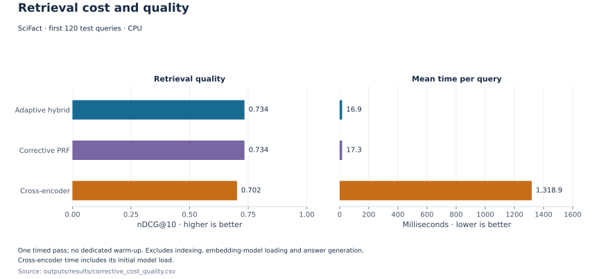
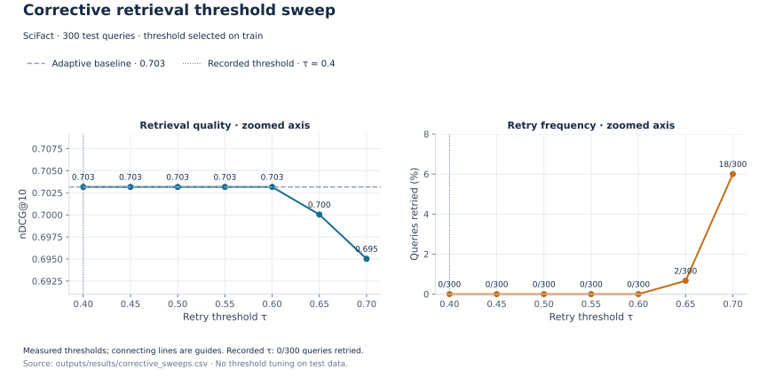
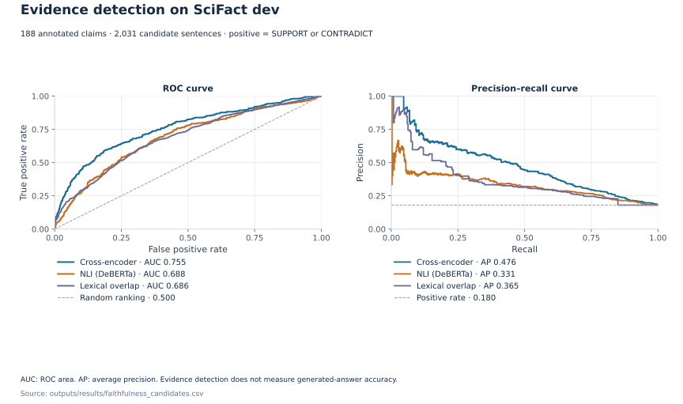

# NexusRAG

NexusRAG is a local app for searching research documents and asking questions about them. Upload papers, ask a question, and read the answer with numbered source excerpts.

**Python · PyTorch · Transformers · BM25**

## Pipeline


[Figma source](https://www.figma.com/design/bRUVlmkQKApYB2bWdHiblv?node-id=29-2)

| Stage | What happens |
| --- | --- |
| Index documents | Extract text from PDF, DOCX, Markdown or UTF-8 text. Split sections and paragraphs into overlapping passages. Store BGE-small vectors in LanceDB and build a BM25 keyword index. |
| Retrieve passages | Search by vector similarity and keywords. Combine the rankings with weighted reciprocal rank fusion; simple rules adjust the weights for the question. A weak dense match can trigger one search with added terms from the leading passages. |
| Generate an answer | Give Ollama up to five complete source blocks within a 6,000-character context budget. The default model, `llama3.2:3b`, is prompted to answer from those passages and cite them as `[1]`, `[2]` and so on. |
| Check source numbers | Remove numeric citations that do not refer to a supplied source. Warn about invalid or missing citations. |

The interface shows the answer, source excerpts, filenames, available page details, response time and warnings. Optional DeBERTa NLI checks estimate sentence support across the supplied passages; they are off by default. Source-number checks and confidence scores do not guarantee a correct answer.

[Upload and indexing recording](assets/media/interface-walkthrough.mp4) · [Pipeline details](docs/pipeline.md)

## Run

Requires Python 3.11.4+ and Ollama. On Apple silicon, PyTorch requires macOS 14 or later. Start `ollama serve` in another terminal if needed.

```bash
git clone https://github.com/urmeo/nexus-rag.git
cd nexus-rag
python3 -m venv .venv
source .venv/bin/activate
python -m pip install -r requirements.txt
ollama pull llama3.2:3b
PYTHONPATH=src python -m scinexusrag.api
```

Open [http://127.0.0.1:8000](http://127.0.0.1:8000), upload a document and wait for indexing. Ask a question, then inspect its numbered source excerpts.

Uncached embedding models download on first use. Documents and indexes default to `data/`. Run **one application worker** because BM25 and rate counters are kept in memory. PDFs need embedded text; OCR is not supported. DOCX body paragraphs and tables are read as text.

[Configuration, limits and checks](CONTRIBUTING.md)

## Results

These saved runs measure passage retrieval and evidence-sentence detection. Generated-answer accuracy has not been evaluated.

### Retrieval quality

SciFact uses **300 test queries over 5,183 abstracts**; NFCorpus uses **323 queries over 3,633 documents**. Each benchmark document is one passage. Search runs on CPU over NumPy vectors; the app chunks uploaded documents and uses LanceDB.

The table shows BM25 and the BGE-small configurations. Higher nDCG@10 means more relevant documents rank nearer the top of the first ten results.

| Retrieval method | SciFact nDCG@10 | NFCorpus nDCG@10 |
| --- | ---: | ---: |
| BM25 | 0.666 | 0.311 |
| BGE-small dense | 0.708 | 0.341 |
| BGE-small + BM25, equal-weight RRF | 0.704 | 0.352 |
| Adaptive weights | 0.703 | 0.346 |
| Adaptive weights + feedback search | 0.703 | 0.346 |

BGE-small dense search has the highest recorded SciFact mean; equal-weight fusion leads on NFCorpus. Adaptive weights and feedback do not consistently improve the recorded scores.



Per-query comparisons show where adaptive fusion improves or lowers the score relative to BGE-small dense retrieval.



### Retrieval time and feedback

A separate run timed the first **120 SciFact test queries**, once on CPU without a dedicated warmup. It excludes indexing, embedding-model loading and answer generation; initial reranker loading is included. On this subset, reranking took longer and scored lower than adaptive hybrid search.



The SciFact sweep triggered no feedback searches at the app's default threshold of **0.55**. Thresholds **0.65** and **0.70** triggered feedback searches and lowered test scores. The marked threshold, **0.40**, was selected on training queries for this separate experiment.



### Evidence detection

This task ranks candidate sentences inside annotated abstracts. It uses **188 SciFact development claims and 2,031 candidate sentences**; 18.0% are annotated evidence supporting or contradicting a claim.

| Evidence scorer | ROC-AUC | Average precision |
| --- | ---: | ---: |
| Lexical overlap | 0.686 | 0.365 |
| NLI relatedness | 0.688 | 0.331 |
| Cross-encoder | 0.755 | 0.476 |

The cross-encoder has the highest recorded scores on this task. NLI relatedness counts both entailment and contradiction as evidence; the app's optional answer checks use entailment. These measurements do not test full-corpus evidence retrieval or answers generated by NexusRAG.



[CSV measurements](outputs/results) · [Evaluation conditions and reproduction](docs/evaluation.md)

## Roadmap

- Evaluate generated-answer accuracy separately from evidence detection.
- Measure indexing and answer-generation time alongside retrieval latency.

## References

- Cormack et al. (2009). [Reciprocal rank fusion outperforms Condorcet and individual rank learning methods](https://doi.org/10.1145/1571941.1572114).
- Lewis et al. (2020). [Retrieval-augmented generation for knowledge-intensive NLP tasks](https://proceedings.neurips.cc/paper/2020/hash/6b493230205f780e1bc26945df7481e5-Abstract.html).
- Thakur et al. (2021). [BEIR: A heterogeneous benchmark for zero-shot evaluation of information retrieval models](https://datasets-benchmarks-proceedings.neurips.cc/paper_files/paper/2021/hash/65b9eea6e1cc6bb9f0cd2a47751a186f-Abstract-round2.html).
- Wadden et al. (2020). [Fact or fiction: Verifying scientific claims](https://doi.org/10.18653/v1/2020.emnlp-main.609).

## License

[MIT](LICENSE).
