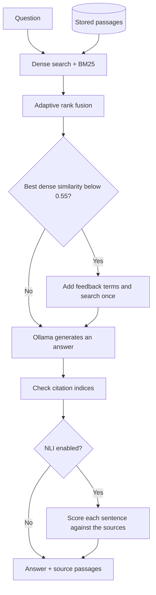

# Pipeline

## Build the index

| Step | Input | Output |
| --- | --- | --- |
| Parse | PDF, DOCX, Markdown or UTF-8 text | Text, sections and available page metadata |
| Split | Parsed text | Overlapping passages with document metadata |
| Embed | Passages | Vectors stored in LanceDB; BGE-small by default |
| Index | Passage text | In-memory BM25 keyword index |

The default chunk target is 1,200 characters, with a 1,500-character maximum and up to 300 characters of paragraph overlap. BM25 is rebuilt from stored chunks and kept in one application process.

## Answer a question

The default generator is `llama3.2:3b`. The corrective search uses terms from the retrieved passages. It runs at most once; it does not retry generation.

Citation validation removes references to nonexistent source indices. It does not establish that a claim is correct. Optional NLI grounding compares each answer sentence with every supplied source and reports its best match. It is off by default; enable it with `SELF_CORRECTION_GROUNDING_ENABLED=true`.

| Output | Meaning |
| --- | --- |
| Answer | Text generated from the retrieved passages |
| Sources | Retrieved passages, document names and available page information |
| Confidence score | NLI grounding score when enabled; otherwise a retrieval and citation-coverage heuristic |
| Warnings | Citation or grounding issues found by the checks |

The application pipeline has no reranking setting. The library and evaluation tools provide a cross-encoder reranker. The separate evidence benchmark also scores contradicting rationale sentences; see [evaluation](evaluation.md).
